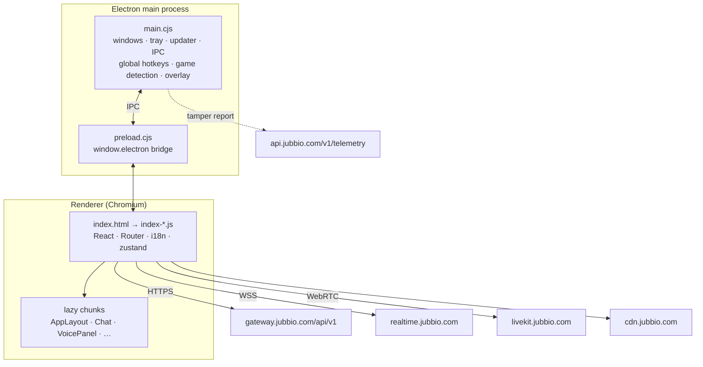

<p align="center">
  
</p>

<p align="center">
  <a href="README.tr.md">Türkçe</a> ·
  <a href="MIMARI.md">Architecture map (TR)</a> ·
  <a href="SECURITY.md">Security</a> ·
  <a href="LICENSE">License</a>
</p>

<p align="center">
  
  
  
  
  
</p>

**jubbio_analiz** is a study of the [Jubbio](https://jubbio.com) desktop client (v3.7.4). The shipped,
obfuscated Vite bundle has been turned back into readable JavaScript, the whole app is mapped in
[`MIMARI.md`](MIMARI.md), and a rebuildable Electron project is included so changes can be tested
locally.

> [!IMPORTANT]
> This is an independent research project. It is **not affiliated with, endorsed by, or supported by
> Jubbio**. The Jubbio client code, name, logos, sounds and images belong to their owners and are
> **not** licensed by this repository. See [LICENSE](LICENSE).

## What's inside

| Folder | Contents |
|---|---|
| [`MIMARI.md`](MIMARI.md) | Architecture map: processes, IPC channels, routes, feature modules, main flows |
| [`okunabilir_kod/assets/`](okunabilir_kod/assets) | The renderer bundle deobfuscated to readable JSX — **for reading** |
| [`electron/`](electron) | The original, unmodified Electron shell (main process, preload, overlay, splash) |
| [`jubbio_derlenebilir/`](jubbio_derlenebilir) | Runnable/packable project built from the readable code (`dist/` + patched `electron/`) |

## Architecture at a glance



The full breakdown (every IPC channel group, route table, feature module and the login / message /
voice flows) is in [`MIMARI.md`](MIMARI.md).

## Getting started

Requirements: Windows 10/11, [Node.js](https://nodejs.org) 20+ and npm.

```bash
git clone https://github.com/rexon01/jubbio_analiz.git
cd jubbio_analiz/jubbio_derlenebilir
npm install
```

| Command | What it does |
|---|---|
| `npm start` | Run the client without packaging (`electron .`) |
| `npm run pack` | Build an unpacked app into `release/win-unpacked/` |
| `npm run dist` | Build an NSIS installer into `release/` |

Edit any file under `jubbio_derlenebilir/dist/assets/` and restart — there is no separate build step.

## Differences from the original client

The rebuildable project in `jubbio_derlenebilir/` is not byte-identical to the shipped app:

- **Tamper telemetry is off.** `detectTampering()` always returns "not detected" and the report to
  `api.jubbio.com/v1/telemetry/tamper-report` is never sent.
- **Optional Tor routing ("Nexus").** New IPC channels `nexus-tor-connect` / `nexus-tor-disconnect`
  start a local `tor.exe` (SOCKS on `127.0.0.1:9050`) and verify it via `check.torproject.org`.
  `tor.exe` is not included; put it in `jubbio_derlenebilir/electron/tor/` if you need it.
- **Separate app identity.** `appId` is `com.jubbio.client.duzenlenmis` and the product name is
  `Jubbio Duzenlenmis`, so it installs side by side with the official client.
- **Auto-update publishing is disabled** (`"publish": null`).

The untouched originals are kept in the root [`electron/`](electron) folder for comparison.

## Notes & limits

- Identifiers like `_0x…` are not the original names; names lost at build time cannot be recovered.
- Module names follow Vite's chunk file names (`AppLayout-BEBJqe9_.js`), since the source tree is gone.
- `uiohook-napi` ships prebuilt (`npmRebuild: false`); rebuilding it needs Visual Studio build tools.
- Using a modified client may break Jubbio's terms of service. Use it on your own account and at
  your own risk.

## Security

Please do not open public issues for vulnerabilities. See [SECURITY.md](SECURITY.md).

## License

Documentation in this repository © 2026 rexon01. Jubbio code and assets remain the property of their
owners and are not licensed here. Details in [LICENSE](LICENSE).

<p align="center"><sub>Made by <a href="https://github.com/rexon01">rexon01</a></sub></p>
