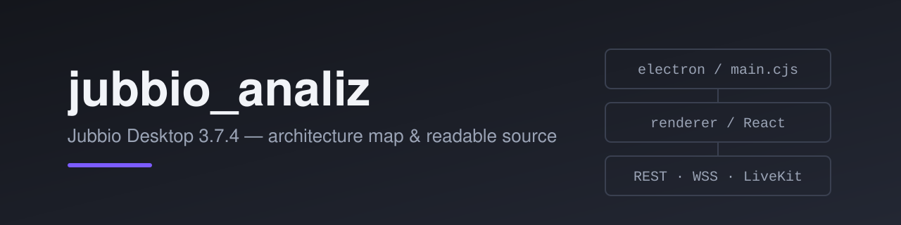
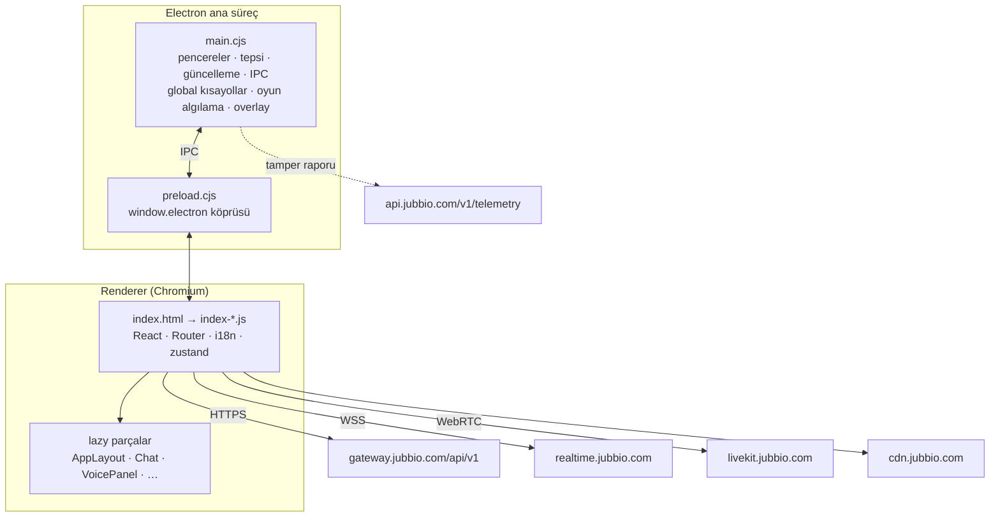

<p align="center">
  
</p>

<p align="center">
  <a href="README.md">English</a> ·
  <a href="MIMARI.md">Mimari haritası</a> ·
  <a href="SECURITY.md">Güvenlik</a> ·
  <a href="LICENSE">Lisans</a>
</p>

<p align="center">
  
  
  
  
  
</p>

**jubbio_analiz**, [Jubbio](https://jubbio.com) masaüstü istemcisinin (v3.7.4) incelemesidir.
Dağıtılan gizlenmiş Vite derlemesi tekrar okunur JavaScript'e çevrildi, uygulamanın tamamı
[`MIMARI.md`](MIMARI.md) içinde haritalandı ve değişiklikleri yerelde denemek için yeniden
paketlenebilen bir Electron projesi eklendi.

> [!IMPORTANT]
> Bu bağımsız bir araştırma projesidir. **Jubbio ile bağlantılı değildir, Jubbio tarafından
> onaylanmamış ve desteklenmemektedir.** Jubbio istemci kodu, adı, logoları, sesleri ve görselleri
> sahiplerine aittir ve bu repo tarafından **lisanslanmaz**. Bkz. [LICENSE](LICENSE).

## İçerik

| Klasör | İçerik |
|---|---|
| [`MIMARI.md`](MIMARI.md) | Mimari haritası: süreçler, IPC kanalları, rotalar, özellik modülleri, ana akışlar |
| [`okunabilir_kod/assets/`](okunabilir_kod/assets) | Arayüz derlemesinin JSX'li okunur hali — **okumak için** |
| [`electron/`](electron) | Orijinal, değiştirilmemiş Electron kabuğu (ana süreç, preload, overlay, splash) |
| [`jubbio_derlenebilir/`](jubbio_derlenebilir) | Okunur kodla çalışan, paketlenebilen proje (`dist/` + yamalı `electron/`) |

## Kısaca mimari



Ayrıntılı döküm (tüm IPC kanal grupları, rota tablosu, özellik modülleri, giriş / mesaj / ses
akışları) [`MIMARI.md`](MIMARI.md) içinde.

## Kurulum

Gereksinimler: Windows 10/11, [Node.js](https://nodejs.org) 20+ ve npm.

```bash
git clone https://github.com/rexon01/jubbio_analiz.git
cd jubbio_analiz/jubbio_derlenebilir
npm install
```

| Komut | Ne yapar |
|---|---|
| `npm start` | Paketlemeden çalıştırır (`electron .`) |
| `npm run pack` | `release/win-unpacked/` içine paketlenmemiş uygulama üretir |
| `npm run dist` | `release/` içine NSIS kurulum dosyası üretir |

`jubbio_derlenebilir/dist/assets/` altındaki herhangi bir dosyayı düzenleyip yeniden başlatman
yeterli; ayrı bir derleme adımı yok.

## Orijinal istemciden farklar

`jubbio_derlenebilir/` içindeki proje dağıtılan uygulamayla birebir aynı değildir:

- **Tamper telemetrisi kapalı.** `detectTampering()` her zaman "algılanmadı" döner ve
  `api.jubbio.com/v1/telemetry/tamper-report` adresine rapor gönderilmez.
- **İsteğe bağlı Tor yönlendirmesi ("Nexus").** Yeni `nexus-tor-connect` / `nexus-tor-disconnect`
  IPC kanalları yerel bir `tor.exe` başlatır (SOCKS `127.0.0.1:9050`) ve `check.torproject.org`
  ile doğrular. `tor.exe` repoda yok; gerekirse `jubbio_derlenebilir/electron/tor/` içine koy.
- **Ayrı uygulama kimliği.** `appId` `com.jubbio.client.duzenlenmis`, ürün adı `Jubbio Duzenlenmis`;
  resmi istemciyle yan yana kurulabilir.
- **Otomatik güncelleme yayını kapalı** (`"publish": null`).

Karşılaştırma için değiştirilmemiş dosyalar kökteki [`electron/`](electron) klasöründe duruyor.

## Notlar ve sınırlar

- `_0x…` gibi adlar orijinal değil; derlemede kaybolan isimler geri getirilemez.
- Kaynak ağaç kaybolduğu için modüller Vite parça adlarıyla anılır (`AppLayout-BEBJqe9_.js`).
- `uiohook-napi` hazır derlenmiş gelir (`npmRebuild: false`); yeniden derlemek Visual Studio derleme
  araçları ister.
- Değiştirilmiş istemci kullanmak Jubbio kullanım koşullarına aykırı olabilir. Kendi hesabında ve
  kendi sorumluluğunda kullan.

## Güvenlik

Güvenlik açıkları için herkese açık issue açma. Bkz. [SECURITY.md](SECURITY.md).

## Lisans

Bu repodaki belgeler © 2026 rexon01. Jubbio kodu ve varlıkları sahiplerine aittir ve burada
lisanslanmaz. Ayrıntılar [LICENSE](LICENSE) içinde.

<p align="center"><sub><a href="https://github.com/rexon01">rexon01</a> tarafından hazırlandı</sub></p>
